# Turnia: recepción con IA para cualquier comercio

Informe del proyecto · Hackatón Donweb Day · **201.32.132.177** (también en `/informe.html`).

Las consultas por WhatsApp, teléfono o en persona se pierden. Esta plataforma las convierte en turnos organizados para cualquier rubro.

## Páginas disponibles

| Dirección | Página | Contenido |
|---|---|---|
| `/` | **Inicio** | Buscador, ofertas destacadas (publicidad de prueba), filtro por tipo de comercio, comercios y “Mis turnos”. |
| `/?c=<comercio>` | **Página del comercio** | Portada, datos, horarios y servicios con foto, precio y ofertas; reserva. |
| `/?ingresar=1` | **Ingreso de clientes** | Acceso por usuario y contraseña, con cuentas de prueba. |
| `/chat.html` | **Asistente** | Chat con apariencia de WhatsApp, identificado por teléfono. |
| `/panel.html` | **Panel del comercio** | Salón, Recepción, Agenda, Estadísticas, Servicios, Plazas, Configuración y Horarios. |
| `/informe.html` | **Informe** | Esta página. |

## Funciones

### Para clientes
- Búsqueda por texto, rubro y sinónimos (“corte de pelo”, “mecánico”, “perro”) y filtro por tipo de comercio, oculto hasta pulsar el botón.
- Orden por cercanía escribiendo la dirección o el barrio.
- Ofertas destacadas y comercios de 11 rubros: cancha, restaurante, peluquería, consultorio, pilates, taller, gomería, lavadero, software, veterinaria y spa.
- Página del comercio con portada, fotos, características, horarios y precios fijos.
- Reserva por servicio, día, cantidad de personas y horario, con asignación automática de la plaza (mesa, sillón, cancha, box…).
- Horarios ordenados por hora y divididos en mañana, tarde y noche; si hoy no hay lugar, salta al primer día disponible.
- Mis turnos con plaza, dirección y cancelación. Registro e ingreso con usuario y contraseña.
- Interfaz para celular y PC: botones de 44 px, nada oculto, esqueletos de carga, avisos de confirmación y estados vacíos con salida.

### Para comercios
- Salón en vivo con resumen y seis estados por color: libre, reserva próxima, hora de llegada, demorado, no se presentó y en atención. En celular, lista por estado o mapa.
- Estadísticas: turnos totales, ocupados, que faltan, cancelados y ausentes; ocupación, próximos 7 días, servicios y plazas más usados, y detalle filtrable (hoy, 7 días o todo).
- Recepción: buscar al cliente y ver a qué plaza ir y cuánto tarda o se demora.
- Agenda del día con estados y acciones (llegó, atendido, cancelar).
- Catálogo de servicios con imagen, precio, duración, características, tipo de plaza y ofertas resaltadas.
- Plazas con forma, tamaño, color, descripción y capacidad; editor del salón con arrastre, cambio de tamaño y líneas guía.
- Perfil con portada, rubro libre con autocompletado, horarios por día y tiempos configurables (aviso, tolerancia, no se presentó).
- Plantillas por rubro para cargar un comercio en segundos.

### Asistente con IA
- Identifica al cliente por su teléfono y conoce la fecha y la hora actuales.
- Busca turnos por servicio y día; si no hay lugar propone el próximo día disponible.
- Reserva, lista y cancela turnos con confirmación previa.
- Consulta ofertas, precios fijos y horarios de atención en el sistema, sin inventar datos, y ofrece respuestas como botones.

### Plataforma
- Reserva atómica: no se puede reservar dos veces la misma plaza.
- Límite de consultas, claves fuera del repositorio y 58 tests automáticos.
- Desplegada en el Cloud Server de Donweb. Ingreso con Google y ubicación automática implementados, pendientes de certificado SSL.

## Lo que ofrecemos

### Para clientes

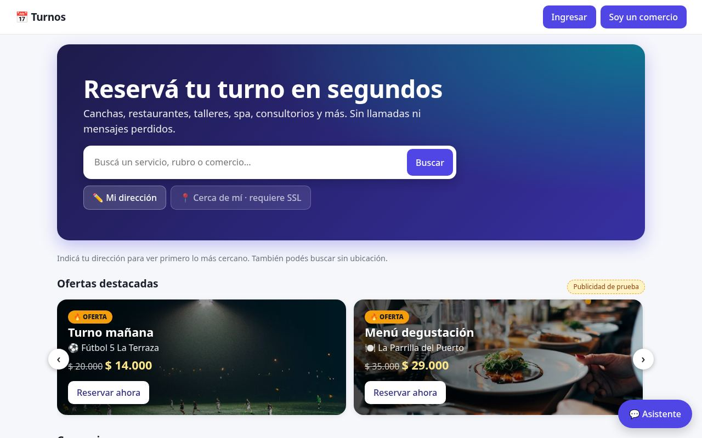
*Inicio con buscador, ofertas destacadas y filtros*

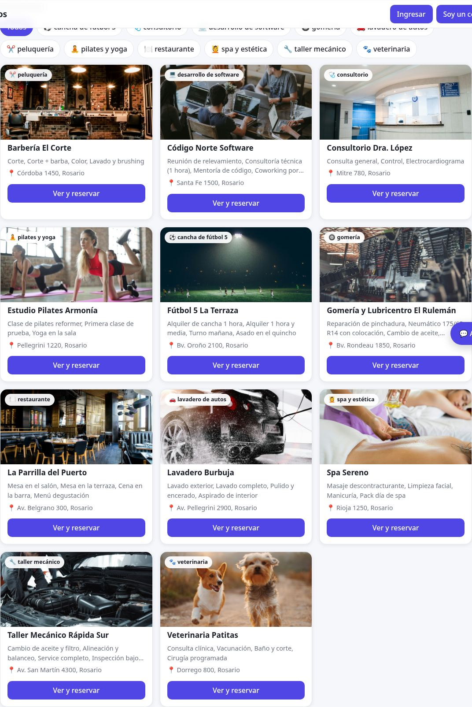
*Comercios de 11 rubros con foto, distancia y servicios*

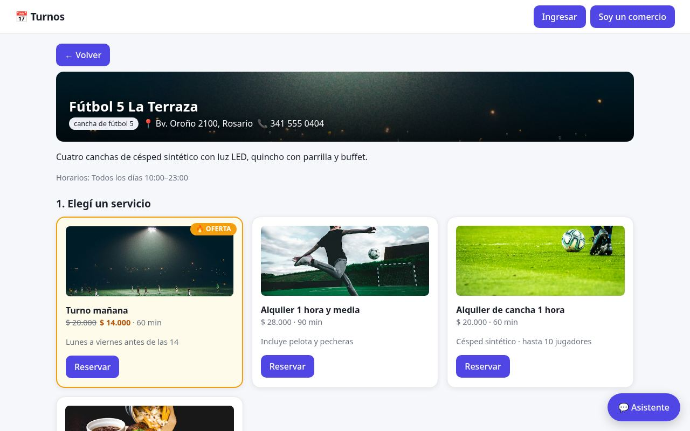
*Página del comercio con portada, ofertas y servicios con foto*

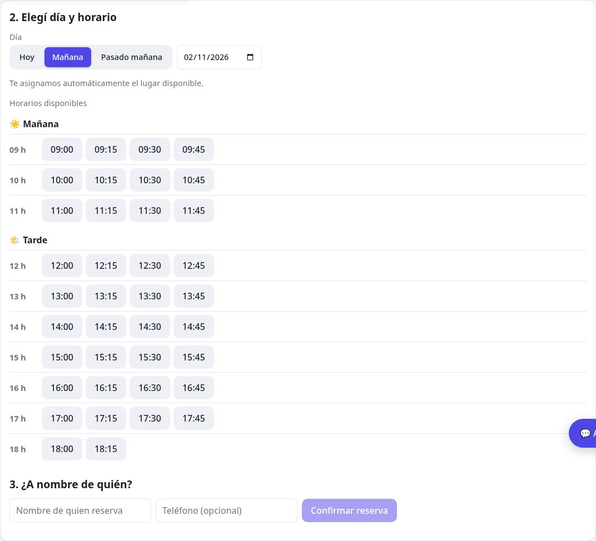
*Horarios ordenados por hora, en mañana y tarde*

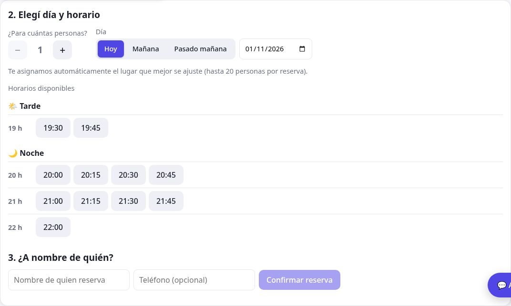
*Reserva: personas, día y horarios libres*

### Para comercios

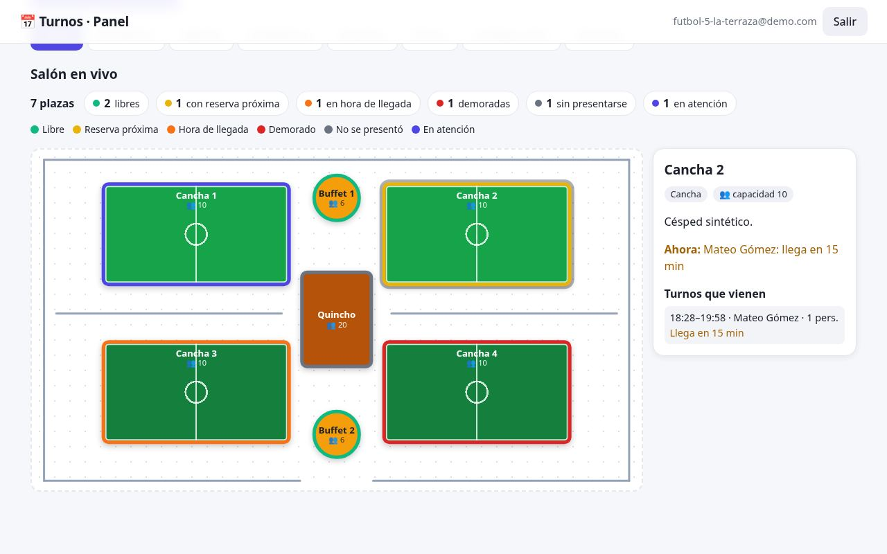
*Salón en vivo: resumen, estados por color y detalle de la plaza*

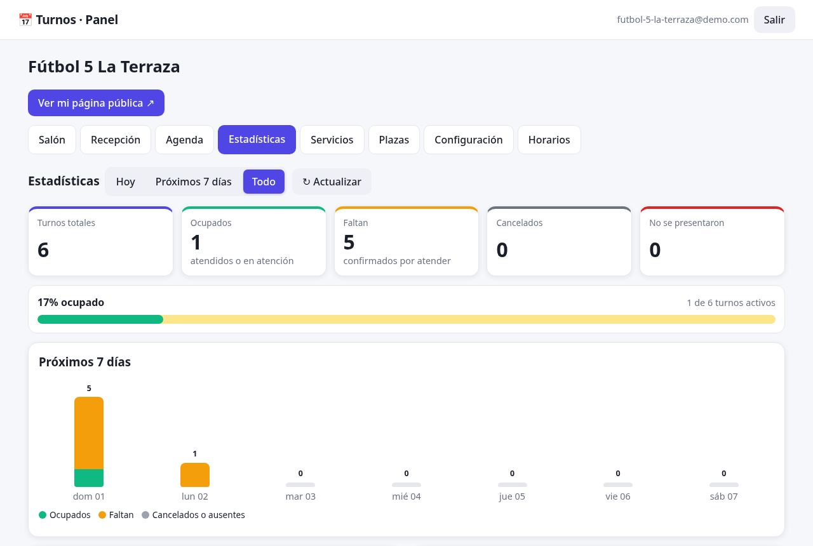
*Estadísticas: turnos totales, ocupados y que faltan*

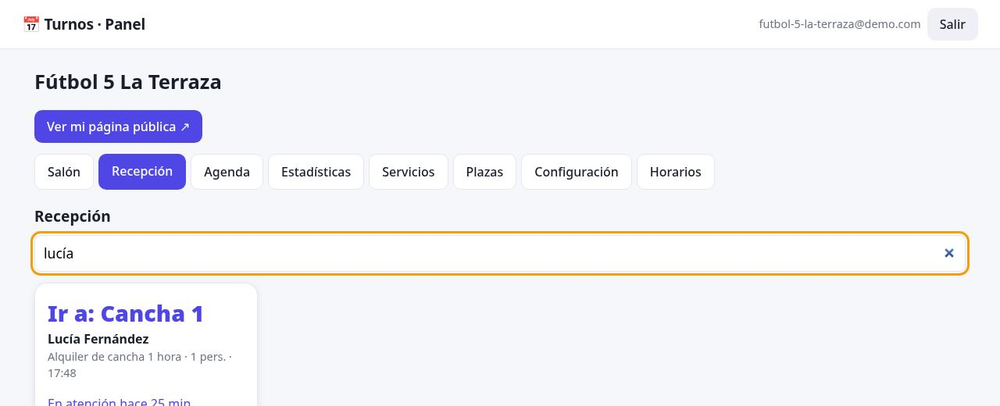
*Recepción: a qué plaza ir y estado de llegada*

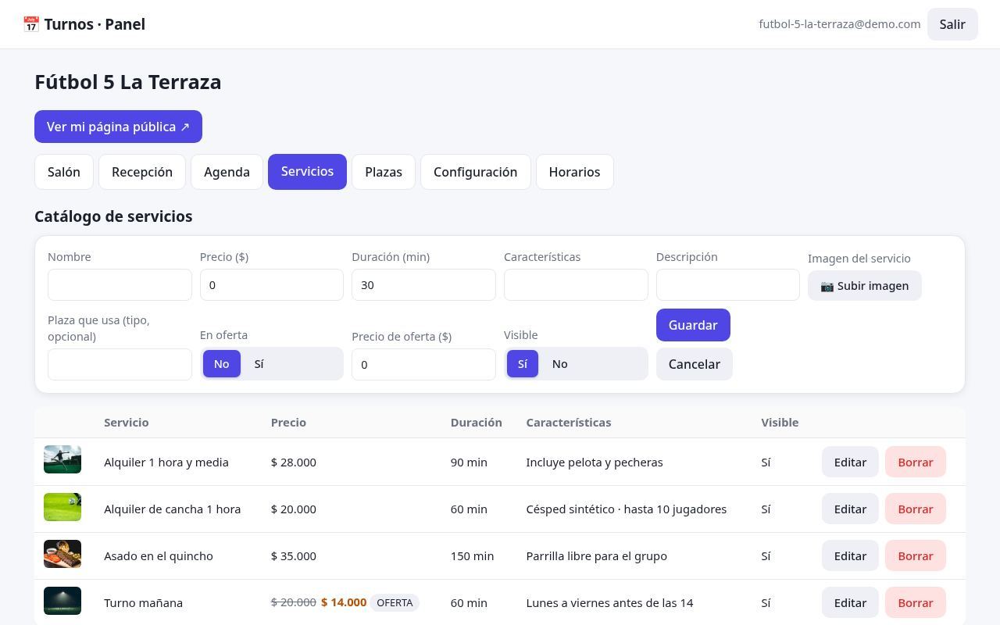
*Catálogo de servicios con imagen, precio y oferta*

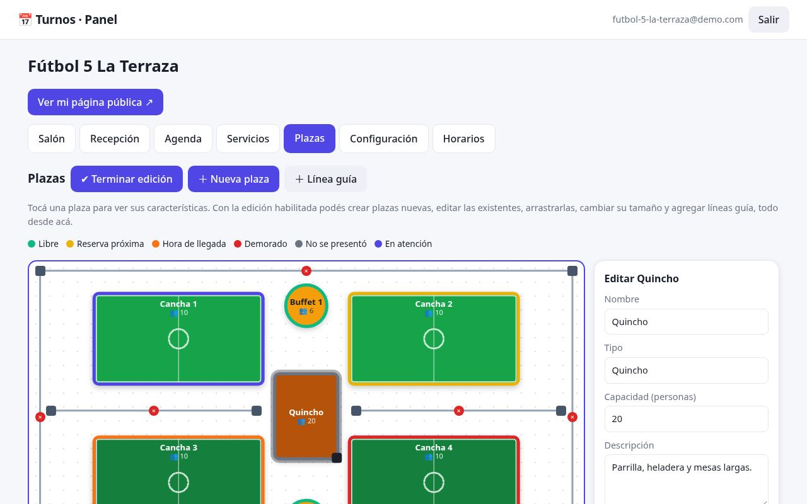
*Editor del salón: plazas, formas, tamaños y líneas guía*

### Una distribución para cada rubro

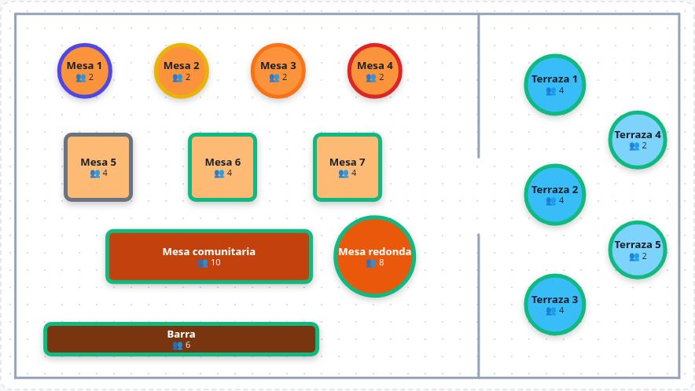
*Restaurante: mesas, barra y terraza*

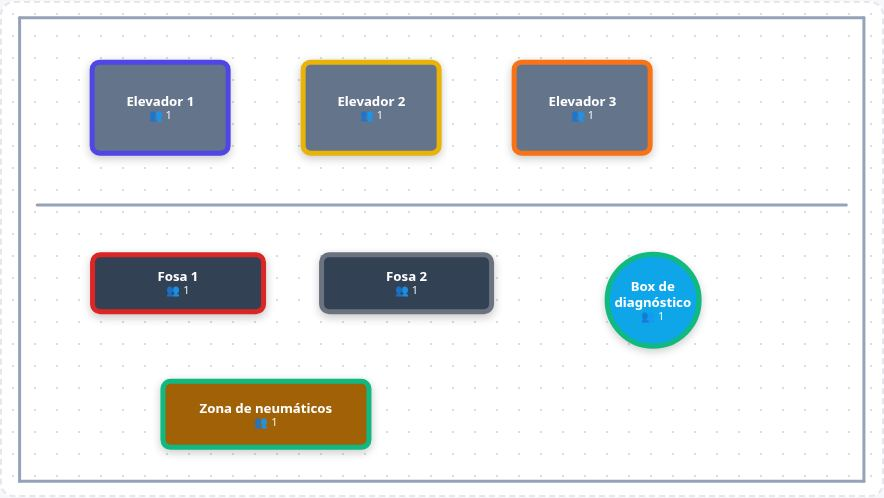
*Taller mecánico: elevadores, fosas y box*

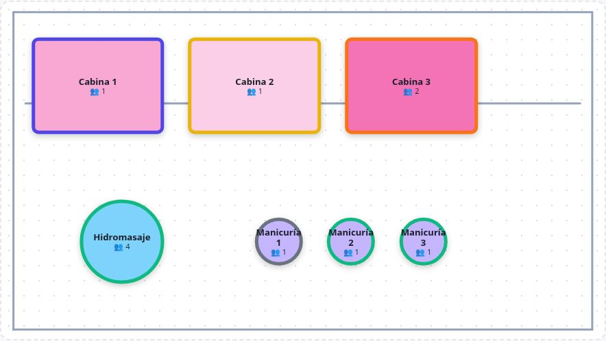
*Spa: cabinas, hidromasaje y manicuría*

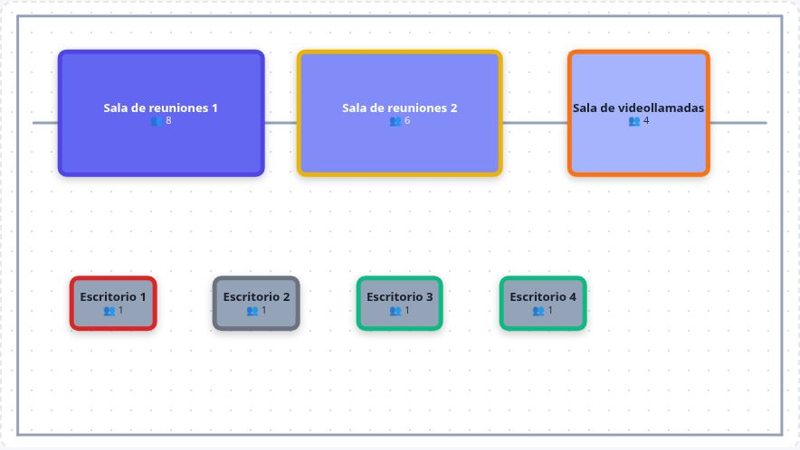
*Estudio de software: salas y escritorios*

### En celular

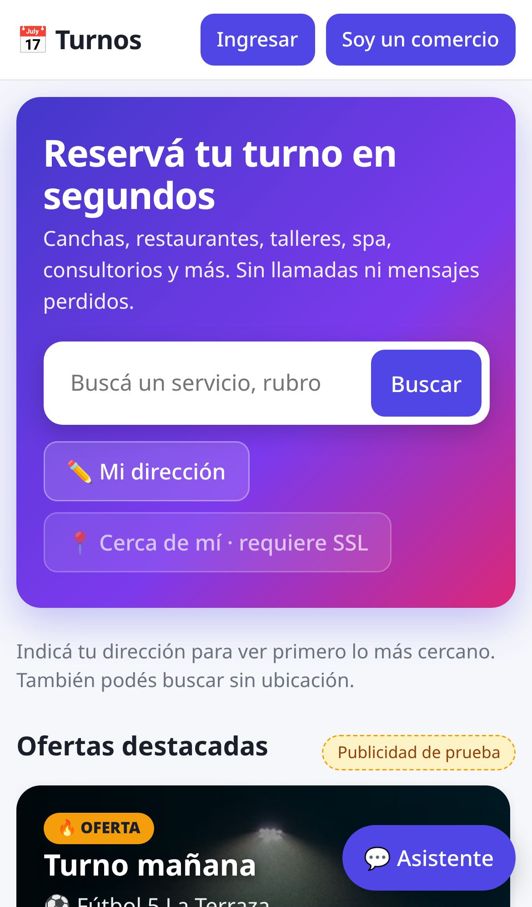
*Inicio en celular*

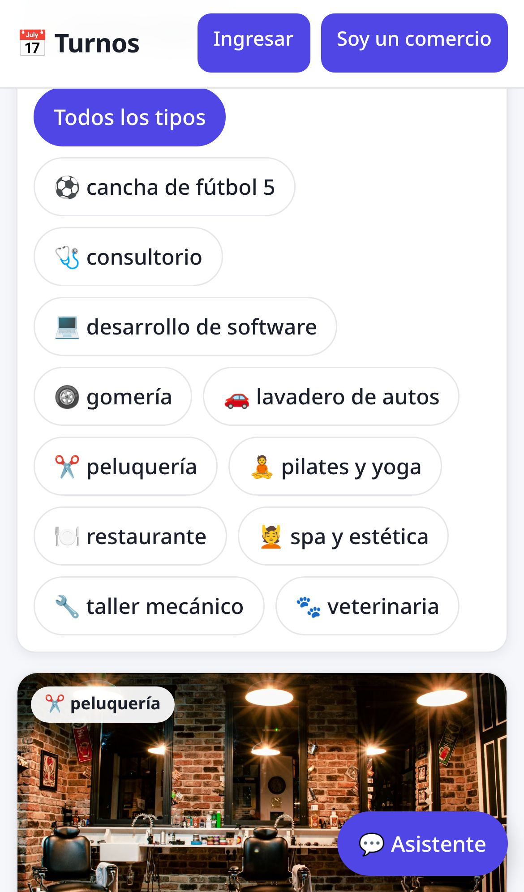
*Filtro por tipo de comercio*

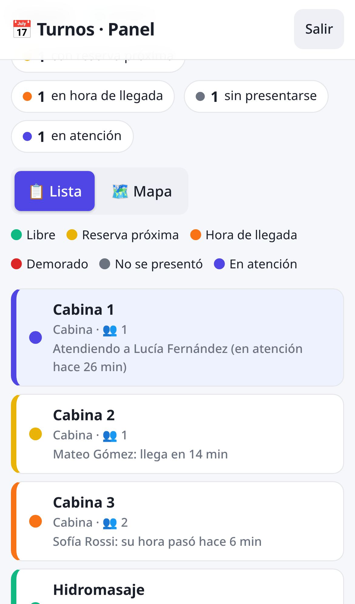
*Salón en celular: lista por estado*

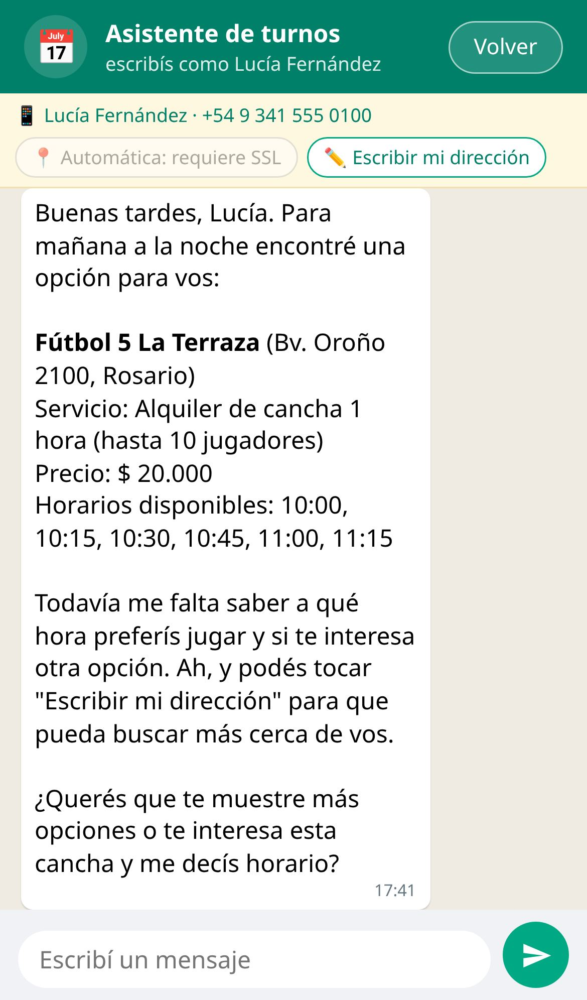
*Asistente estilo WhatsApp*
