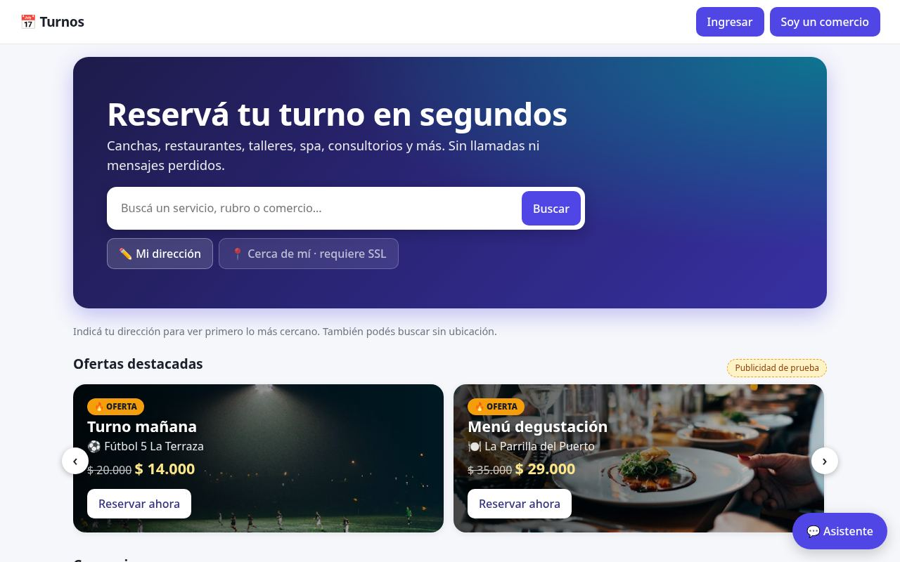
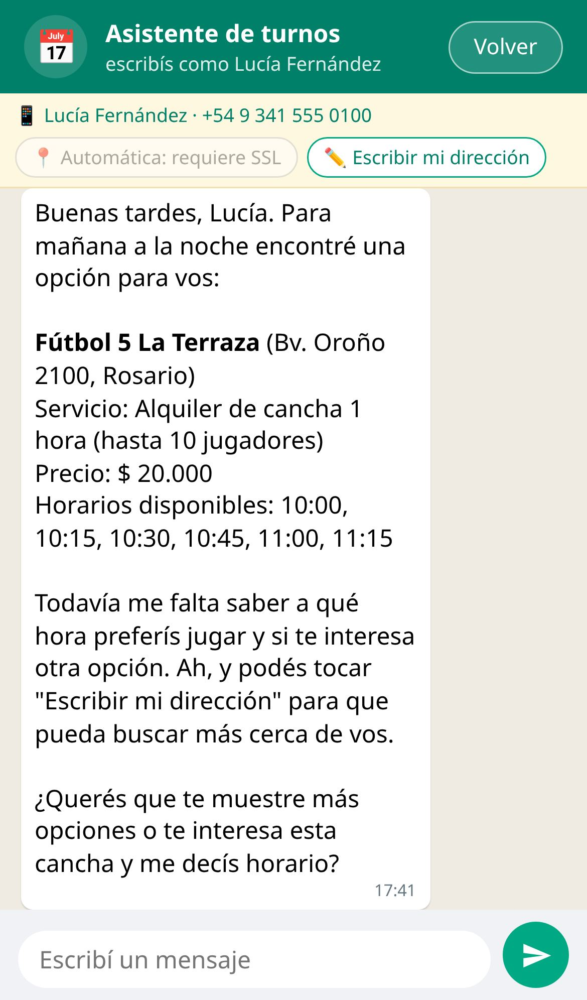
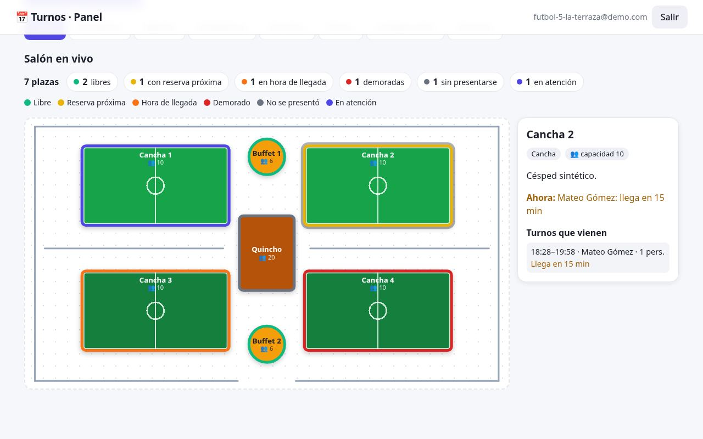
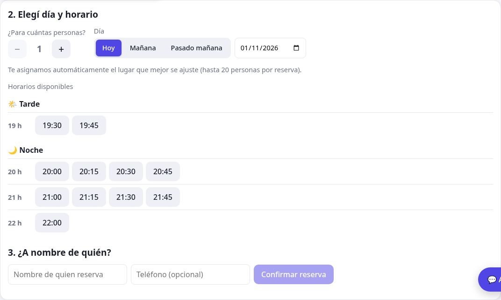

# Turnia

**Recepción con IA para cualquier comercio.** Plataforma de turnos y reservas para restaurantes, peluquerías, consultorios, canchas y talleres, con un asistente conversacional que reserva, consulta y cancela por el cliente.

Construido en una tarde (15:15 a 18:30) para el **Hackatón Donweb Day, "Del problema al servidor"** (Tecnoteca, Rosario, 1/11/2026) y desplegado en un Cloud Server de Donweb.



| Asistente de IA | Salón en vivo | Reserva |
|---|---|---|
|  |  |  |

**Demo en vivo: https://turnia.store**

Informe completo con funciones y capturas: [INFORME.md](INFORME.md).

## El problema

Las consultas llegan por WhatsApp, teléfono o en persona, y los mensajes se pierden o se anotan mal. El cliente espera, no recibe respuesta y se va.

## La solución

Un solo modelo (**servicio + plaza**) que sirve para cualquier rubro, con dos caras:

- **Cliente** (`/`): busca comercios por texto, rubro o cercanía, elige servicio, día, personas y horario, y reserva en segundos. Ve sus reservas en **Mis turnos**.
- **Asistente** (`/chat.html`): conversa en lenguaje natural, busca turnos cercanos, reserva, lista y cancela.
- **Comercio** (`/panel.html`): catálogo de servicios (precio, duración, imagen, ofertas), **plazas** (mesas, canchas, camillas) dibujadas en un mapa del salón, salón en vivo con estados, recepción, agenda del día y estadísticas.

## Stack

| Capa | Tecnología |
|---|---|
| Servidor | Node.js 26, Fastify 5 |
| Datos | SQLite (`node:sqlite`, modo WAL), sin dependencias nativas |
| Frontend | HTML, CSS y JavaScript sin paso de build |
| IA | API de OpenAI con herramientas (function calling) |
| Tests | `node --test` (75 tests) |

## Decisiones técnicas

- **Sin doble reserva:** la reserva corre en una transacción atómica (`BEGIN IMMEDIATE`) y asigna la plaza libre más ajustada a la cantidad de personas.
- **IA que no inventa:** el asistente solo consulta y modifica a través de funciones del sistema (buscar, disponibilidad, reservar, mis turnos, cancelar). Los precios son fijos y se informan tal cual. Incluye timeout y reintentos con backoff ante 429 y 5xx.
- **Alta demanda:** límite de consultas por IP y por ruta, SQLite en WAL y sin build.
- **Ubicación:** "Cerca de mí" usa la geolocalización del navegador (requiere HTTPS) y como alternativa se escribe una dirección (OpenStreetMap). Las coordenadas se guardan solo en el navegador.
- **Ingreso con Google:** implementado y deshabilitado hasta configurar las credenciales OAuth.

## Puesta en marcha

Requiere Node 26.12 o superior.

```sh
npm ci
npm run semilla      # carga 11 comercios de ejemplo (necesita internet la primera vez)
npm start            # http://localhost:3000
npm test
```

### Configuración

Las variables se leen de `~/.env`, fuera del repositorio:

| Variable | Uso |
|---|---|
| `OPENAI_API_KEY` | Asistente de IA |
| `OPENAI_MODEL` | Modelo (opcional) |
| `SESSION_SECRET` | Firma de la cookie de sesión |
| `PORT` | Puerto (por defecto 3000) |
| `DB_PATH`, `UPLOAD_DIR` | Ubicación de la base y de las imágenes subidas |
| `CUENTAS_PRUEBA=1` | Muestra botones de ingreso con las cuentas de prueba |
| `MONITOR_TOKEN` | Habilita `/monitor.html` (sin él, el monitor está oculto) |
| `TRUST_PROXY=1`, `HOST` | Detrás de un proxy inverso: IP real del visitante y escucha solo en local |

### Actualizar un despliegue

```sh
npm run actualizar
```

Hace `fetch`, y si la rama está detrás de su remoto avanza con `fast-forward` y reinstala dependencias. No toca nada si hay cambios locales o commits sin publicar.

## Cuentas de prueba

Clave `test123`: cliente `cliente@test.com` y un usuario por comercio, `<slug>@demo.com` (por ejemplo `futbol-5-la-terraza@demo.com`).

## Demo (2 minutos)

1. **Cliente:** escribir una dirección, ver comercios por cercanía, filtrar por rubro y abrir *Fútbol 5 La Terraza*.
2. **Reserva:** servicio, "Mañana", 8 personas, horario; crear cuenta y recibir la cancha asignada.
3. **Asistente:** "quiero jugar al fútbol mañana a la noche": propone opciones, confirma y reserva; luego "¿qué turnos tengo?" y cancelar.
4. **Comercio:** entrar como `futbol-5-la-terraza@demo.com`: salón en vivo, recepción ("Ir a: Cancha 1") y edición de plazas.

## Seguridad

- HTTPS con certificado de Let's Encrypt (Caddy como proxy inverso, renovación automática) y HSTS.
- Cabeceras: CSP estricta (`script-src 'self'`), `X-Frame-Options`, `nosniff`, `Referrer-Policy` y `Permissions-Policy` (geolocalización solo del propio sitio).
- Contraseñas con scrypt; cookie de sesión firmada, `httpOnly`, `SameSite=Lax` y `Secure` bajo HTTPS.
- Límite global de consultas por IP y límite estricto en login y registro (fuerza bruta).
- Claves fuera del repositorio; los logs no incluyen cookies ni tokens.
- 17 tests de seguridad (`test/seguridad.test.js`): cabeceras, cookies, sesiones falsificadas, inyección SQL, path traversal, cuerpos grandes y fuerza bruta.

## Monitor de tráfico

`/monitor.html` muestra pedidos, visitantes únicos, errores, qué se busca, rubros filtrados, rutas más usadas, pedidos por hora y visitantes sospechosos (muchos 401/403/404 o bloqueos por límite). Se accede con el token `MONITOR_TOKEN`; sin él, el monitor responde 404. Las IP se guardan con hash salado y los registros se borran a los 30 días.

## Despliegue

Servidor: Cloud Server de Donweb con Debian, `systemd` y Caddy. La app escucha en `127.0.0.1:3000` con `TRUST_PROXY=1` y Caddy publica `turnia.store` por HTTPS. Para actualizar un clon con git, `npm run actualizar`.

---

Licencia [MIT](LICENSE). Hecho por Salvador Sánchez. Los datos y la publicidad son de prueba.
